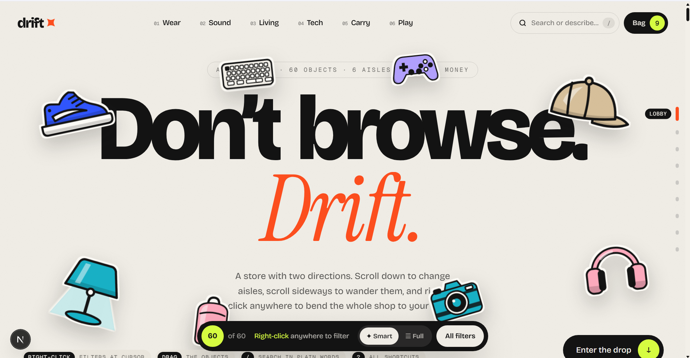

# drift ✦ — a store that moves

A preview shopping experience built with Next.js 16, Motion and Lenis. All 60 products, brands and reviews are made up, and checkout only prints a pretend receipt. No payment is ever taken.

```bash
npm install
npm run dev      # http://localhost:3000
```

## Preview



## How to drive it

| Do this | What happens |
| --- | --- |
| **Right-click** anywhere | Filters appear at your cursor, in your chosen mode |
| Right-click **on a product** or **an aisle heading** | The smart ring offers filters about *that* thing (cheaper than this, same colour, this brand, hide this kind…) |
| **Hold right-click, flick, release** | Marking-menu style: picks a wedge without a second click |
| **Shift + right-click** | The other mode (smart ring ↔ full panel) |
| `1`–`6` / `0` / `Tab` while the ring is open | Pick a wedge / reset / switch to the full panel |
| **Alt + right-click** | The browser's normal context menu |
| `F` | Summon at the cursor without the mouse |
| `/` | Search in plain words, e.g. "cozy blue lamps under 80" |
| `Z` or `Ctrl+Z` | Undo the last filter change |
| `M` | Change your default right-click mode (also in the dock) |
| `B` / `?` | Bag / all shortcuts |

The **dock** at the bottom is always there: live result count, active filter chips, undo, mode switch and the full filter panel.

## Layout

- **Lobby**: kinetic headline and draggable product stickers.
- **The Drop**: a pinned section where scrolling down moves you sideways along an arc.
- **The Aisles**: one horizontal shelf per category. Drag, shift-scroll or swipe through it.
- **The Floor**: the full grid. It reflows with animation whenever filters change.

Filters apply to every section at once, and the page holds your place while content above you grows or shrinks.

## Where things live

- `lib/data.ts`: seeded dummy catalogue (deterministic, so server and client agree)
- `lib/filters.ts`: filter model, chips, and the plain-language search parser
- `lib/smart.ts`: context-aware smart filter suggestions, including "My taste" built from what you've viewed
- `components/Summoner.tsx`: right-click handling, the radial ring, and the at-cursor panel
- `components/Glyph.tsx`: hand-drawn SVG product illustrations (no image hosting needed)
